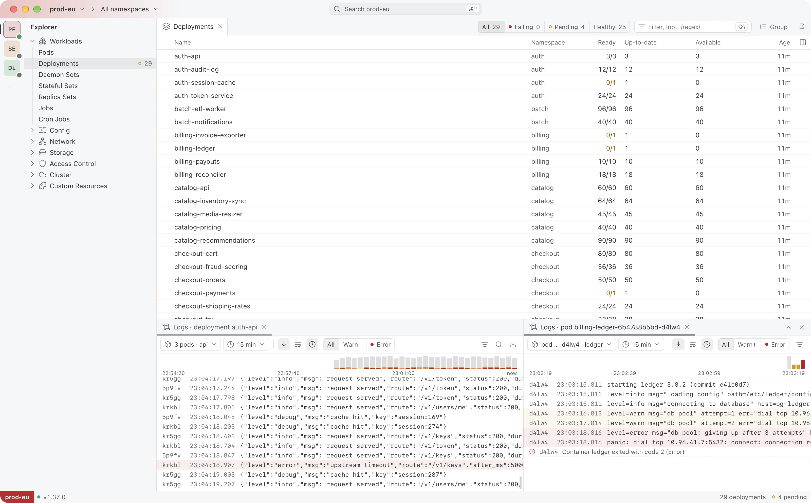
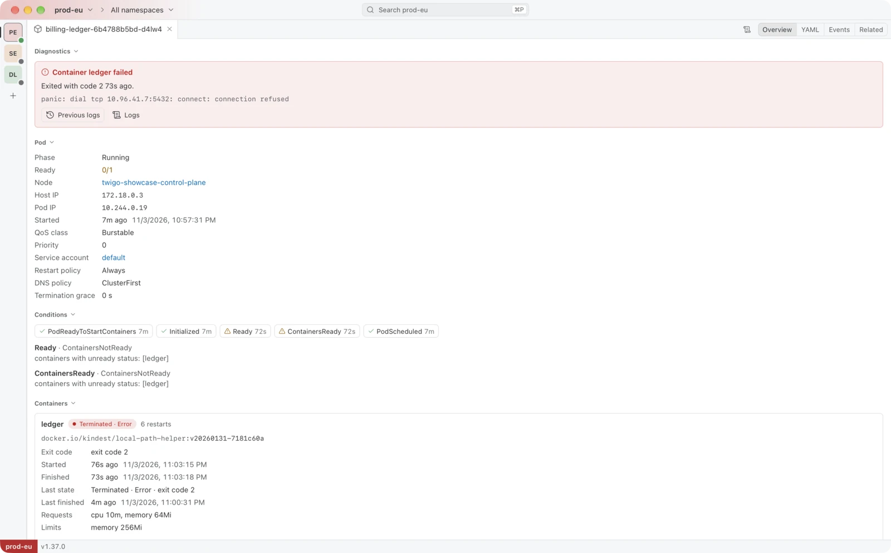
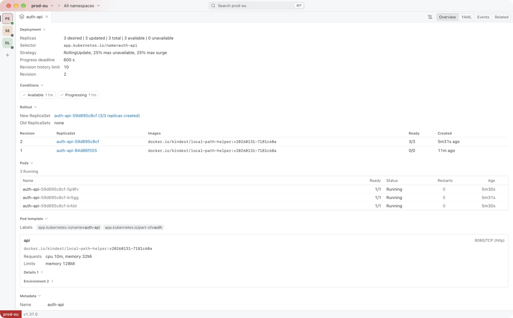
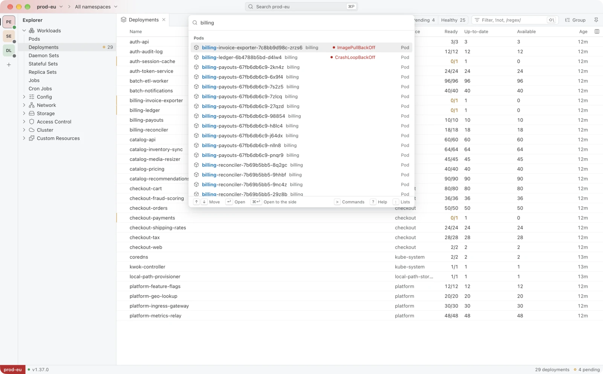
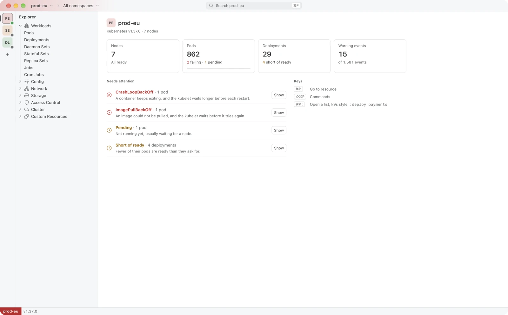

  

<h1 align="center">Twigo</h1>

<b>A desktop IDE for Kubernetes — fast, keyboard-first, and open source.</b>

  <picture>
    <source media="(prefers-color-scheme: dark)" srcset="./images/workbench-dark.webp">
    
  </picture>

Twigo opens the clusters in your kubeconfig and shows what needs attention first: the pods that fail, why they fail in plain words, and the logs of the container that crashed.
It reads the kubeconfig kubectl already uses, so contexts never live in two places.
A native app built with Rust and Tauri, with no account and no telemetry.

<table>
  <tr>
    <td width="50%" valign="top">
      <picture>
        <source media="(prefers-color-scheme: dark)" srcset="./images/overview-pod-dark.webp">
        
      </picture>
      
<b>What is wrong, first.</b> Objects open on an overview that puts problems on top: a crash loop, an image that cannot be pulled, a pod that waits for a node.

    </td>
    <td width="50%" valign="top">
      <picture>
        <source media="(prefers-color-scheme: dark)" srcset="./images/overview-deployment-dark.webp">
        
      </picture>
      
<b>Objects, not YAML dumps.</b> Rollout history, live tables of the pods behind a workload, conditions and links to related objects; YAML and events are a tab away.

    </td>
  </tr>
  <tr>
    <td width="50%" valign="top">
      <picture>
        <source media="(prefers-color-scheme: dark)" srcset="./images/quick-access-dark.webp">
        
      </picture>
      
<b>Keyboard-first.</b> <kbd>⌘P</kbd> finds a pod or a recent editor by name, <kbd>⇧⌘P</kbd> runs any command, and <code>:deploy payments</code> opens a list the k9s way.

    </td>
    <td width="50%" valign="top">
      <picture>
        <source media="(prefers-color-scheme: dark)" srcset="./images/cluster-home-dark.webp">
        
      </picture>
      
<b>One space per cluster.</b> Each cluster keeps its own layout and colour, so production never looks like staging, and its home lists what needs attention.

    </td>
  </tr>
</table>

### Also in the box

- Logs of a whole deployment at once that follow its rollouts, with a histogram of levels and the previous container a click away.
- Live lists of every kind, custom resources included, filtered with `!not` and `/regex/`.
- Sign-in through exec plugins and OIDC, even when Twigo starts from the Dock.
- Kubernetes 1.33 and later.

### Status

Twigo is in early development and has no release yet.
Reading clusters works today; editing with a dry-run diff, exec, port-forward, Helm and an MCP server for AI agents come next.
The first beta ships for macOS and Linux, and Windows follows right after.
Follow [twigo/twigo](https://github.com/twigo/twigo) for the source and the first release, under the Apache-2.0 licence.
